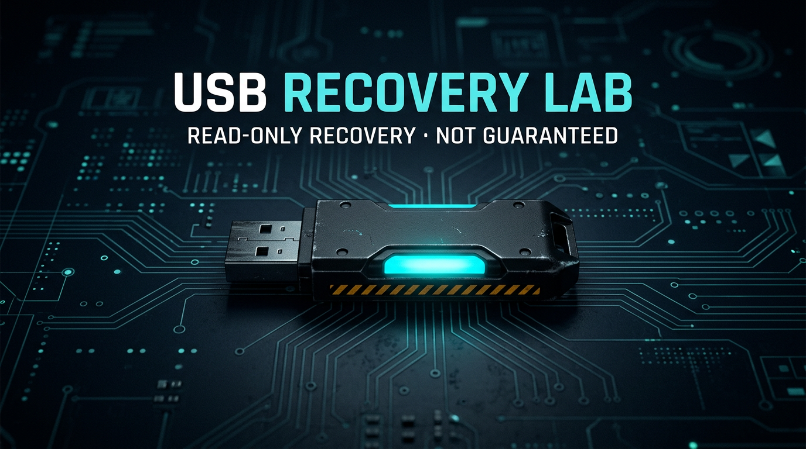
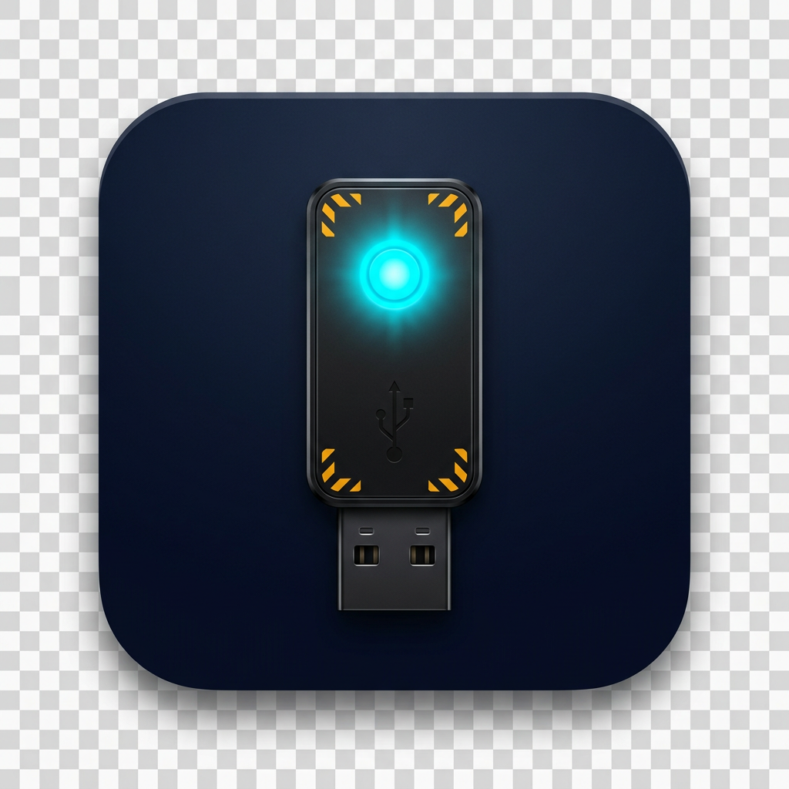

<div align="center">





# USB Recovery Lab

**Read-only recovery of deleted, lost, and carved files from USB pen drives and disk images.**

[](https://www.python.org/)
[](LICENSE)
[](#4-install-step-by-step)
[](#6-command-reference)
[](#43-optional--desktop-gui)
[](docs/FEATURES.md)
[](docs/SAFETY.md)

[Install](#4-install-step-by-step) · [Quick start](#5-quick-start-practice-on-a-fake-stick) · [Commands](#6-command-reference) · [Safety](docs/SAFETY.md) · [Features](docs/FEATURES.md) · [Methods](docs/RECOVERY_METHODS.md)

</div>

---

> [!CAUTION]
> **Recovery is not guaranteed.** Confidence scores are heuristic explanations, **not probabilities**. This program never formats, repairs, or writes to the source device. A read-only file descriptor does **not** stop a USB bridge or NAND controller from writing.

> [!IMPORTANT]
> Stop using the stick. Unmount it. **Image first** onto a healthy disk. Recover onto a **different physical disk**. Never execute recovered files.

---

## Contents

1. [What this is](#1-what-this-is)
2. [Safest practical approach](#2-safest-practical-approach)
3. [What you need](#3-what-you-need)
4. [Install, step by step](#4-install-step-by-step)
5. [Quick start (practice on a fake stick)](#5-quick-start-practice-on-a-fake-stick)
6. [Command reference](#6-command-reference)
7. [Real USB workflow](#7-real-usb-workflow)
8. [Python API](#8-python-api)
9. [What is implemented](#9-what-is-implemented)
10. [Configuration](#10-configuration)
11. [Tests](#11-tests)
12. [Windows `.exe` packaging](#12-windows-exe-packaging)
13. [Exit codes](#13-exit-codes)
14. [Limitations](#14-limitations-honest)
15. [Troubleshooting](#15-troubleshooting)
16. [License](#16-license)

---

## 1. What this is

USB Recovery Lab is an **offline, read-only** recovery toolkit:

| Layer | Color | Role |
| --- | --- | --- |
| 🟦 **Acquire** | cyan | List USB devices, open `O_RDONLY`, optional raw `.dd` image |
| 🟩 **Parse** | green | MBR/GPT, FAT12/16/32, exFAT, NTFS `$MFT` |
| 🟨 **Carve** | amber | JPEG, PNG, PDF, ZIP/OOXML, video/audio headers, … |
| 🟪 **Explain** | violet | Heuristic scores, evidence explorer, strategy reports |
| 🟥 **Export** | red | Recover to another disk, hash, sidecar, HTML/JSON/CSV report |

Three equivalent fronts share the same engine: **CLI**, optional **PySide6 GUI**, and a **Python API**. The GUI never talks to a device on the UI thread.

```
Python 3.11+   ·   CLI = stdlib only   ·   GUI extra = PySide6   ·   SQLite sessions
360 catalog IDs   ·   synthetic tests   ·   no telemetry   ·   MIT
```

---

## 2. Safest practical approach


1. **Stop using the pen drive.** Do not save new files onto it.
2. **Unmount / eject** so the OS stops journaling.
3. **Image first** onto a healthy disk (`usb-recovery image …`). Work from the `.dd` after that.
4. Run a **quick** metadata scan, then **standard** / **deep** carving if needed.
5. Recover selected files onto a **different physical disk**.
6. Verify hashes. Open recovered copies with a viewer — **never execute them**.

For high-value forensic work use a **hardware write blocker**. This app does not replace that. Details: [docs/SAFETY.md](docs/SAFETY.md).

---

## 3. What you need

| You want to… | Need |
| --- | --- |
| Scan / recover from a `.dd` / `.img` | Python **3.11+**, this repo, no extra packages |
| Desktop wizard | Same, plus **PySide6** (`pip install -e ".[gui]"`) and a display |
| Image a **Linux** USB (`/dev/sdX`) | `disk` group or `sudo`, confirm token `I_UNDERSTAND_READ_ONLY` |
| Image a **Windows** USB | Administrator, `\\.\PhysicalDriveN`, same confirm token |
| Run the test suite | `pip install -e ".[dev]"` (pytest) |

> [!NOTE]
> Core engine and CLI have **zero required third-party packages**. Network and telemetry flags in config are **ignored and forced off**.

---

## 4. Install, step by step

### 4.1 Linux (Debian / Ubuntu / Fedora)

**Step 1 — install Python 3.11+ and git**

```bash
# Debian / Ubuntu
sudo apt update
sudo apt install -y python3 python3-venv python3-pip git

# Fedora
sudo dnf install -y python3 python3-pip git
```

Check:

```bash
python3 --version    # must be 3.11 or newer
git --version
```

**Step 2 — clone this repository**

```bash
git clone https://github.com/mrdineshpathro-dot/usb-recovery.git
cd usb-recovery
```

**Step 3 — create an isolated virtualenv** (do not use system pip)

```bash
python3 -m venv .venv
source .venv/bin/activate
python -m pip install -U pip
```

Your prompt should show `(.venv)`.

**Step 4 — install the lab**

```bash
# CLI only (stdlib engine — recommended on servers / headless)
pip install -e .

# Optional desktop UI
pip install -e ".[gui]"

# Optional test tools
pip install -e ".[dev]"

# Everything
pip install -e ".[all]"
```

**Step 5 — verify the install**

```bash
usb-recovery --version
python -m usb_recovery --help
usb-recovery setup --dest ~/recovered
usb-recovery readiness
```

You should see the app name, a command list, first-run checks, and a 360-ID readiness board.

**Step 6 — (physical USB only) allow raw disk reads**

```bash
# either
sudo usermod -aG disk "$USER"
# then log out and back in
# or run imaging commands with sudo
```

Physical opens still require:

```text
--confirm I_UNDERSTAND_READ_ONLY
```

---

### 4.2 Windows 10 / 11

**Step 1 — install Python 3.11 or 3.12**

1. Download from [python.org](https://www.python.org/downloads/).
2. Run the installer.
3. Tick **Add python.exe to PATH**.
4. Open a **new** PowerShell and check:

```powershell
py -3 --version    # 3.11 or 3.12
```

**Step 2 — install Git** (if you do not have it)

[git-scm.com/download/win](https://git-scm.com/download/win), then:

```powershell
git --version
```

**Step 3 — clone**

```powershell
git clone https://github.com/mrdineshpathro-dot/usb-recovery.git
cd usb-recovery
```

**Step 4 — virtualenv**

```powershell
py -3 -m venv .venv
.\.venv\Scripts\Activate.ps1
python -m pip install -U pip
```

If activation is blocked:

```powershell
Set-ExecutionPolicy -Scope CurrentUser RemoteSigned
.\.venv\Scripts\Activate.ps1
```

**Step 5 — install**

```powershell
pip install -e .            # CLI
pip install -e ".[gui]"     # + desktop UI
pip install -e ".[dev]"     # pytest
```

**Step 6 — verify**

```powershell
usb-recovery --version
python -m usb_recovery setup --dest $HOME\recovered
python -m usb_recovery readiness
```

**Physical drives** (`\\.\PhysicalDriveN`, `\\.\E:`) need an **elevated** PowerShell (Run as administrator) and `--confirm I_UNDERSTAND_READ_ONLY`.

---

### 4.3 Optional — desktop GUI

```bash
pip install -e ".[gui]"
usb-recovery-gui
# or
python -m usb_recovery gui
```

Needs a display (X11 / Wayland / Windows desktop). Headless boxes stay on the CLI.

---

### 4.4 Optional — portable data directory

```bash
export USB_RECOVERY_HOME="$PWD/usb-recovery-data"   # Linux
#  $env:USB_RECOVERY_HOME = "$PWD\usb-recovery-data"  # Windows PowerShell
usb-recovery setup
```

Sessions, logs, and the SQLite DB then live next to the app instead of in your user profile.

---

### 4.5 Confirm it actually works (60 seconds)

```bash
usb-recovery lab --scenario deleted_fat --dest /tmp/practice.img
usb-recovery info /tmp/practice.img
usb-recovery scan /tmp/practice.img --profile standard
```

A synthetic FAT16 image is written and scanned. **No real USB is touched.**

---

## 5. Quick start (practice on a fake stick)

> [!TIP]
> Practice on `usb-recovery lab` images first. Never “try it out” on the victim stick.

```bash
# 1. First-run checks
usb-recovery setup --dest ~/recovered

# 2. Write a known-good practice image
usb-recovery lab --scenario deleted_fat --dest /tmp/practice.img
# other scenarios: mbr_fat | carve_only | gpt_empty

# 3. Inspect
usb-recovery info /tmp/practice.img

# 4. Scan
usb-recovery scan /tmp/practice.img --profile standard
# copy the Session id from the output

# 5. Recover onto another folder (never back onto the source)
usb-recovery recover /tmp/practice.img --session sess-… --dest ~/recovered

# 6. Report
usb-recovery report sess-… --dest ~/recovered/report.html --format html
```

Ask the assistant before a real case:

```bash
usb-recovery advise --symptom deleted --filesystem fat32
usb-recovery explain --topic trimmed
usb-recovery plan-scan --goal photos --filesystem fat32 --size 8000000
usb-recovery help-search TRIM
```

---

## 6. Command reference

The console script **`usb-recovery`** is installed by pip. `python -m usb_recovery` is equivalent.

| Command | What it does |
| --- | --- |
| `list-devices` | Removable USB (add `--all` for other block devices) |
| `info <source>` | Identity, size, mounts, warnings |
| `image <src> <dest>` | Raw DD image, checkpoints, SHA-256, bad-sector map |
| `scan <source>` | Metadata + carving → SQLite session |
| `recover <source>` | Copy selected IDs to `--dest` (another disk) |
| `report <session>` | JSON / HTML / CSV |
| `gui` | Desktop wizard |
| `diagnostics` | Sanitized support bundle |
| `advise` / `assess` / `explain` / `diagnose` | Assistant |
| `search <session>` | Natural-language / `--fuzzy` search |
| `lab` | Synthetic practice image |
| `benchmark` / `fuzz` | Timing + parser fuzz |
| `inspect-image` / `convert-image` / `compare-images` / `provenance` | Image containers |
| `setup` / `help-search` / `readiness` | First run, offline help, feature board |
| `identity-check` | Reconnection identity |
| `evidence` / `match-known` / `plan-scan` | Multi-evidence + known-content + plan |
| `scorecard` / `sign-manifest` / `isolate-parse` / `evidence-dashboard` | Quality, HMAC, isolated validators |

### Scan flags

```bash
usb-recovery scan path/to/stick.dd --profile quick|standard|deep
usb-recovery scan path/to/stick.dd --no-carve --no-metadata
usb-recovery scan path/to/stick.dd --signatures jpeg,png,pdf
usb-recovery scan path/to/stick.dd --sector-range 0:100000
usb-recovery scan path/to/stick.dd --image-offset 1048576
usb-recovery scan path/to/stick.dd --exclude-types tmp,lnk
usb-recovery scan path/to/stick.dd --json
```

### Imaging a physical device

```bash
# Linux
usb-recovery image /dev/sdb ~/safe/stick.dd --confirm I_UNDERSTAND_READ_ONLY

# Windows (elevated)
usb-recovery image \\.\PhysicalDrive2 D:\safe\stick.dd --confirm I_UNDERSTAND_READ_ONLY
```

> [!WARNING]
> Destination must be a **different physical disk** unless you pass `--allow-same-device` and accept the risk of overwriting evidence.

---

## 7. Real USB workflow

```bash
# 1. See the stick (do not mount it)
usb-recovery list-devices

# 2. Identity + warnings
usb-recovery info /dev/sdb --confirm I_UNDERSTAND_READ_ONLY

# 3. Image onto a healthy disk
usb-recovery image /dev/sdb ~/safe/stick.dd --confirm I_UNDERSTAND_READ_ONLY
# unplug the stick. work from the image after this.

# 4. Assess, then scan
usb-recovery assess ~/safe/stick.dd
usb-recovery scan ~/safe/stick.dd --profile standard --json

# 5. Recover onto yet another folder/disk
usb-recovery recover ~/safe/stick.dd \
  --session sess-… \
  --dest ~/recovered \
  --ids id1,id2 \
  --sidecar

# 6. Evidence pack
usb-recovery report sess-… --dest ~/recovered/report.html --format html
usb-recovery sign-manifest ~/safe/stick.dd --dest ~/recovered/manifest.json --key lab-hmac
usb-recovery evidence sess-…
```

Unreadable sectors are zero-filled in the image and listed in `*.bad-sectors.json`. Resume uses `*.checkpoint.json`. If the device identity changed after unplug, resume is refused.

---

## 8. Python API

```python
from usb_recovery import RecoveryLab
from usb_recovery.models import ScanOptions

lab = RecoveryLab()
session, found = lab.scan(
    "tests/images/mbr-fat16.img",
    options=ScanOptions.from_profile("standard"),
)
lab.recover(
    "tests/images/mbr-fat16.img",
    found[:5],
    "/tmp/recovered",
    session_id=session,
)
lab.export_report(session, "/tmp/report.json", fmt="json")
```

UI, device access, scanning, and recovery are separate packages. Import what you need; the engine still refuses to write the source.

---

## 9. What is implemented

| Area | Working now |
| --- | --- |
| 🔌 Devices | USB listing (Linux sysfs, Windows removable), disk images, `O_RDONLY` |
| 💾 Imaging | Raw DD, checkpoints, retries, bad-sector JSON, SHA-256 |
| 🧱 Partitions | MBR (+ EBR), GPT + backup compare, super-floppy fallback |
| 📂 Filesystems | FAT12/16/32 deleted entries + LFN, exFAT deleted sets, NTFS `$MFT` |
| ✂️ Carving | JPEG, PNG, GIF, BMP, WebP, PDF, ZIP/OOXML, RAR/7z headers, OLE, SQLite, audio/video headers |
| 📦 Recovery | Destination checks, no overwrite, hierarchy, size + hash verify |
| 🖥️ UI | CLI + PySide6 wizard (dark/light, assistant page) |
| 🧭 Advisor 201–210 | Rule-based assistant, assessment, effort, limitations, scores |
| 🧩 Reconstruct 211–220 | Matching, fragments, photos, ZIP salvage, timeline |
| 🔥 Flash 221–230 | Heatmap, adaptive retries, stop thresholds, USB IDs, resume identity |
| 📤 Output 231–240 | Transactional writes, vault, sidecars, dest checks, second copy |
| 🗂️ Workspace 241–250 | NL/fuzzy search, bookmarks, batches, profiles |
| 🛡️ Security 251–260 | Suspicious-file warnings, isolated preview, fuzz, signed plugins |
| 💿 Images 261–270 | Split/gzip/fixed-VHD/offset/sparse, inspect, convert, compare, provenance |
| 🔬 Analysis 271–280 | Alignment, consistency, byte-map, unicode names, temp/thumb/RAW, WAL |
| 📋 Workspace 281–290 | Scan plans, exclusions, tags, history search, job queue, folder templates |
| 🧰 Platform 291–300 | Portable home, setup wizard, help search, dashboard, a11y, identity-check |
| 🧪 Devtools 301–310 | Corpus, validator, crash self-test, migrations, plugin API, readiness |
| 🧠 Algorithms 311–320 | Multi-evidence rank, fragment graph, constraints, fusion, known-content, evidence |
| 🧬 FS reconstruction 321–330 | FAT history, NTFS graph/journal inspect, exFAT bitmap, slack, competing layouts |
| 🎞️ Difficult files 331–340 | JPEG/MP4/ZIP/PDF/OOXML/WAL/NAL/audio/RAW salvage on **isolated copies** |
| 🤖 Automation 341–350 | Local linear classifier, adaptive plan, cost, anomalies, FP filter, scorecard |
| 🔏 Integrity 351–360 | Signed manifest, provenance, pipeline, isolated parsers, plugin caps, dashboard |
| ✅ Tests | Synthetic FAT/MBR/GPT/carve images — **no real USB required** |

Exact per-ID status: [docs/FEATURES.md](docs/FEATURES.md). Filesystem limits: [docs/FILESYSTEMS.md](docs/FILESYSTEMS.md). Method details: [docs/RECOVERY_METHODS.md](docs/RECOVERY_METHODS.md).

```
src/usb_recovery/
  safety.py            mandatory data-protection rules
  devices/             Linux sysfs + Windows ctypes adapters, disk images
  imaging/             resumable DD copy, bad-sector map, SHA-256
  partitions/          MBR, GPT (backup compared, never repaired)
  filesystems/         FAT12/16/32, exFAT, NTFS $MFT (documented limits)
  carving/             versioned signatures + structural validators
  recovery/            scan engine, confidence, verify, export
  advanced/            multi-evidence rank, fragment graph, known-content
  fsdeep/              FAT history, NTFS graph, slack, competing layouts
  special/             JPEG/MP4/ZIP/PDF/OOXML/WAL salvage (copies only)
  intel/               planner, classifier, scorecard
  forensics/           manifest, pipeline, isolated parsers
  db/                  SQLite sessions, candidates, audit events
  cli/  gui/  api.py   three equivalent fronts on the same engine
```

---

## 10. Configuration

Defaults: [`config/default.toml`](config/default.toml).

```bash
cp config/default.toml config/local.toml
# or
export USB_RECOVERY_CONFIG=/path/to/local.toml
```

| Section | Controls |
| --- | --- |
| `[safety]` | Same-device block, confirm token, retry budget |
| `[imaging]` | Block size, checkpoints, hash-while-imaging |
| `[scan]` | Profile, carve window, workers |
| `[recovery]` | No-overwrite, hierarchy, verify |

Network and telemetry keys are **ignored and forced off**.

---

## 11. Tests

Tests use **synthetic** FAT16, MBR, GPT, and carving images. They never open a real USB device.

```bash
pip install -e ".[dev]"
python -m pytest
```

Rebuild sample images:

```bash
python scripts/generate_test_images.py
```

---

## 12. Windows `.exe` packaging

> [!NOTE]
> **No executable is shipped** with this source tree. If you did not run the packager, there is no `.exe`.

On a Windows machine with Python 3.11+:

```powershell
pip install -e ".[gui]" pyinstaller
powershell -File scripts\build_windows.ps1
```

See [docs/PACKAGING.md](docs/PACKAGING.md). Output (when built): `dist\USBRecoveryLab.exe`.

---

## 13. Exit codes

| Code | Color | Meaning |
| --- | --- | --- |
| **0** | 🟢 | Success |
| **1** | 🔴 | Unexpected error |
| **2** | 🟠 | Usage error |
| **3** | 🟣 | Safety / confirmation failure |
| **4** | 🔵 | Source access error |
| **5** | 🟤 | Destination error |
| **6** | ⚪ | Cancelled |
| **7** | 🟡 | Partial success (bad sectors or mixed recoveries) |

---

## 14. Limitations (honest)

- Deleted FAT 8.3 names lose the first character (`0xE5`).
- Zeroed FAT chains use a **contiguous-cluster heuristic** and a low score.
- NTFS `$LogFile` is listed for timeline context, **never replayed**.
- ext4 is **detected**, not reconstructed.
- Dynamic / differencing VHD and full AFF4 map replay are **not** implemented.
- Carving finds format signatures; it cannot un-fragment arbitrary files.
- ZIP/PDF “repairs” run on an **isolated copy**, never on the source.
- The local classifier is a **linear feature model**, not a neural network.
- Live USB bridges may still write. This app cannot prevent that.

| Action | Rights | Optional external tool |
| --- | --- | --- |
| Scan a `.dd` / `.img` | none | — |
| Image `/dev/sdX` | root or `disk` | — |
| Image `\\.\PhysicalDriveN` | Administrator | — |
| E01 / ddrescue / TestDisk | not in this MVP | 008, 197, 198 are stubs |

---

## 15. Troubleshooting

| Symptom | What to do |
| --- | --- |
| Access denied (Linux) | Unmount, then `sudo` or add user to `disk` and re-login |
| Access denied (Windows) | Elevated terminal, `\\.\PhysicalDriveN` |
| Device not listed | `usb-recovery list-devices --all`, or scan a `.dd` |
| Failing stick / bad sectors | **Stop deep scans.** Image with retries. Read `*.bad-sectors.json` |
| No candidates | `--profile deep`, check `info`, try `--image-offset` |
| Same-device block | Recover onto another disk, or `--allow-same-device` (risky) |
| GUI missing | `pip install -e ".[gui]"` and a real display |

Full notes: [docs/TROUBLESHOOTING.md](docs/TROUBLESHOOTING.md).

```bash
usb-recovery diagnose "Permission denied"
usb-recovery diagnostics --dest support.json
```

---

## 16. License

MIT. See [LICENSE](LICENSE).

<div align="center">


**USB Recovery Lab** · read-only · offline-first · recovery is not guaranteed

[Safety](docs/SAFETY.md) · [Features](docs/FEATURES.md) · [Methods](docs/RECOVERY_METHODS.md) · [Packaging](docs/PACKAGING.md)

</div>
